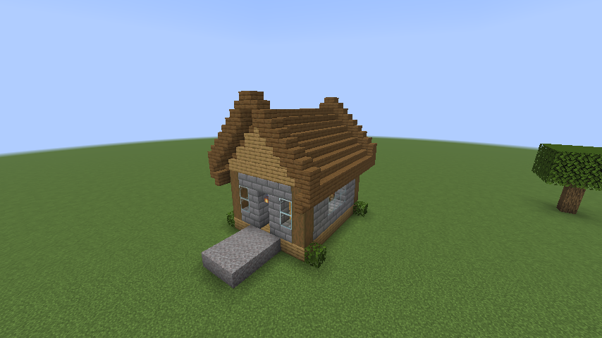
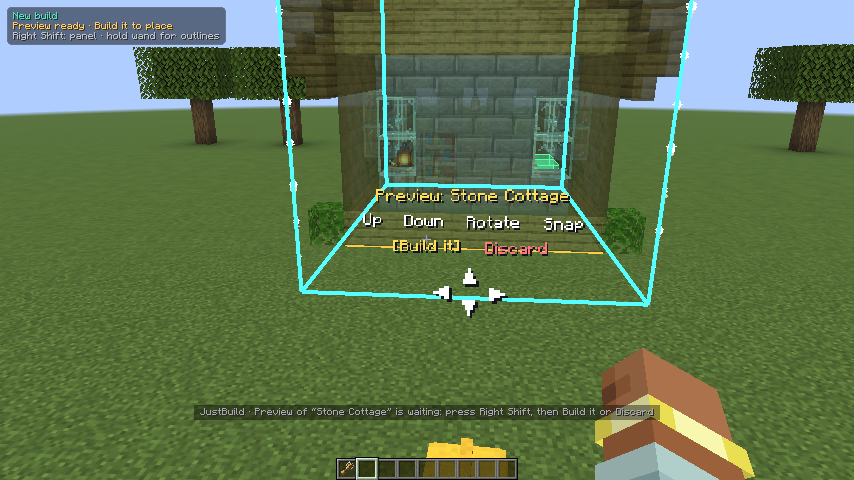
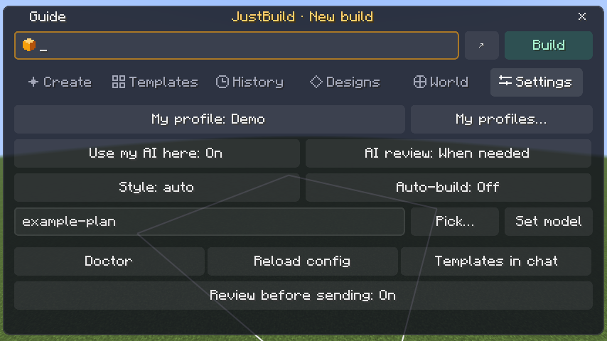

<!--
  Demo videos: each "video:" comment below names a local MP4 in docs/demos/ (kept out of git).
  Drag that file into GitHub's README editor, then replace the image just above the comment with
  the uploaded link on a line of its own. GitHub only plays it when the link stands alone.
-->

<div align="center">

# JustBuild

**Describe a build. An AI plans it, you preview it, and it goes up block by block in your world.**


[](LICENSE)

[Features](#features) · [Bring your own AI](#bring-your-own-ai) · [Installation](#installation) ·
[Quick start](#quick-start) · [Multiplayer](#multiplayer) · [Documentation](#documentation)

</div>


<!-- video: docs/demos/02-first-build.mp4 -->

JustBuild is a Fabric mod that turns plain-English requests into real builds. Ask for a cottage, a watchtower, or
a bridge between two houses. The AI plans the structure, JustBuild checks the plan and shows it as a ghost preview,
and nothing is placed until you say so. Every build stays editable afterwards, with saved versions and undo.

It works with the AI you already have: Claude Code, Codex, Grok Build, or any OpenAI-compatible API.

> [!NOTE]
> JustBuild is in development and has no public release yet. To try it, [build the jar from source](#building-from-source).

## Features

### Describe it, preview it, build it

Type what you want. The plan appears as a ghost preview you can walk around, raise, lower, or rotate before
choosing **Build it** or **Discard**.


<!-- video: docs/demos/24-in-world-controls.mp4 -->

### Pick exactly where it goes

The Builder Wand marks out the area: two corners for a rectangle, or any number of points for an irregular footprint.
Corners can be moved right in the world.


<!-- video: docs/demos/09-polygon-footprint.mp4 (or 01-select-area.mp4) -->

### Keep editing

Select a finished building and describe the change: "add a chimney", "swap the roof to dark oak". Compare
before and after layer by layer, and lock the parts you want left alone.


<!-- video: docs/demos/03-edit-building.mp4 -->

### Go back to any version

Every change is saved. Browse the visual version history, restore an earlier version, or undo your last action.


<!-- video: docs/demos/11-version-history.mp4 -->

### Meet Cobble

Cobble, a small builder robot, walks around the site and hammers away while the AI plans and blocks go down.
Nearby players with the mod see him too.

<!-- video: docs/demos/14-alternatives-and-builder.mp4 -->

### And more

<table>
  <tr>
    <td width="50%"><b>Building workshop</b><br>Swap materials, repair damage, plan interiors, and name parts.<br></td>
    <td width="50%"><b>Village projects</b><br>Group buildings under a shared style and palette, then connect them with paths and bridges.<br></td>
  </tr>
  <tr>
    <td><b>Schematics</b><br>Export and import Litematica <code>.litematic</code> and Sponge <code>.schem</code> files.<br></td>
    <td><b>Build checks</b><br>Find construction problems and check that every room can be reached on foot.<br></td>
  </tr>
</table>

Also included: 24 starting templates, two or three alternatives to choose between, reusable prompts, height and
material limits, and adding builds you made by hand so the AI can edit them.

## Bring your own AI

JustBuild doesn't run a service of its own. Requests go to the provider you pick, using your own subscription or
API key.

| Provider | Uses | Setup |
| --- | --- | --- |
| Claude Code | Your Claude subscription | Install the `claude` CLI and run `claude auth login`. The desktop app alone isn't enough. |
| Codex | Your ChatGPT subscription | Install the `codex` CLI and run `codex login`. |
| Grok Build | Your Grok account | Install the `grok` CLI and run `grok login`. |
| OpenAI-compatible API | An API key | Pick a preset (OpenAI, OpenRouter, DeepSeek, Groq, Mistral, xAI, Gemini, Qwen, Experiential Labs) or a local Ollama or LM Studio server, then choose a model. |

Save up to 20 profiles, such as one fast model and one careful one, and switch between them in one click.

- **Cost:** builds use your plan's limits or API credits. **Workshop → AI usage** shows calls, tokens, and AI time,
  and can cap a session.
- **What the AI sees:** your request plus snapshots of the build area. Container contents, sign text, books, and
  entity data are left out. CLI providers run with your personal instructions, skills, and memory turned off.
- **Your keys:** API keys are encrypted on disk, and the key that unlocks them is kept outside the game folder, in your
  operating system's credential store or a private vault folder. See [credential storage](docs/security-credentials.md).

## Safe by default

- Every new AI build waits as a preview until you confirm it.
- Occupied containers and locked areas are protected.
- Builds won't bury players, pets, named mobs, or villagers.
- Fire, lava, and TNT are rejected.
- Undo restores the saved blocks and asks for confirmation first.

## Installation

**Requirements:** Minecraft Java Edition 26.1.2 · Fabric Loader 0.19.2 or newer · Fabric API · Java 25 or newer

1. Create a Fabric instance for Minecraft 26.1.2 in your launcher.
2. Put [Fabric API](https://modrinth.com/mod/fabric-api) and `justbuild-<version>.jar` in the instance's `mods` folder.
3. Start the game, open a world, and press **Right Shift**.

For multiplayer, install the same version on the server too.

## Quick start

Press **Right Shift → Guide** for an in-game walkthrough, or follow these steps.

1. **Connect your AI.** Open **Settings → Manage profiles…**, choose a provider and model, and press
   **Test connection**. Save the profile and make it the active one.
2. **Mark the area.** You get a Builder Wand when you join a world. Left-click one ground corner, then right-click
   the opposite corner.
3. **Describe the build.** On the **Create** tab, type something like
   *"A small medieval cottage with a steep spruce roof and a stone foundation"* and press **Build**.
4. **Check the preview.** Walk around it, then choose **Build it** or **Discard**.
5. **Change it.** Sneak-right-click the building with the wand, describe the change, and press **Apply**.

Everything is also available as commands. `/jb` is short for `/justbuild`.

| Command | What it does |
| --- | --- |
| `/jb build <description>` | Start a new build |
| `/jb edit <change>` | Change the selected building |
| `/jb confirm` | Place the waiting preview |
| `/jb undo` | Undo your last action |
| `/jb doctor` | Check your AI setup |
| `/jb help` | List every command |

Commands work for the singleplayer owner and LAN host without cheats, and for server operators.

## Multiplayer

Each player can plan builds with their own AI from their own game, so nobody has to share an account. Turn on
**Settings → Use my AI here** for a server you trust. It's off for every server until you do. Your login or API key
never leaves your computer; the server receives the AI's plan, checks it, and places the blocks.


<!-- video: docs/demos/22-multiplayer-ai.mp4 -->

Server owners choose whether players must bring their own AI, may fall back to the server's, or always use the
server's. See [your own AI on a server](docs/user-guide.md#your-own-ai-on-a-server).

## Documentation

- [User guide](docs/user-guide.md): every control, command, and setting
- [Schematic formats](docs/schematic-formats.md): what imports and exports, and the limits
- [Credential storage](docs/security-credentials.md): where keys live and how to recover them

Settings are in `config/justbuild.json`. Builds, versions, and undo history are saved in each world's `justbuild`
folder, so back it up with the world.

## Building from source

You need a JDK 25. The Gradle wrapper handles the rest. If Gradle can't find your JDK, add its path as
`org.gradle.java.installations.paths` in `~/.gradle/gradle.properties`.

```sh
./gradlew build
```

The mod jar is written to `build/libs/`. On Windows, use `gradlew.bat`.

| Task | What it does |
| --- | --- |
| `./gradlew runClient` | Start a development game with the mod loaded |
| `./gradlew test` | Run the unit tests |
| `./gradlew runClientGameTest` | Open Minecraft and run the scripted game tests |

See [testing](docs/testing.md) for running single game tests, the opt-in checks, and CI.

## Reporting problems

[Open an issue](../../issues) with what you asked for, what happened, and the output of `/jb doctor`.

## License

JustBuild is free software under the [GNU Lesser General Public License v3.0](LICENSE). You can use, share, and
change it, and other mods can build on it freely. If you distribute a modified version of JustBuild itself, its
source must stay available under the same license.
