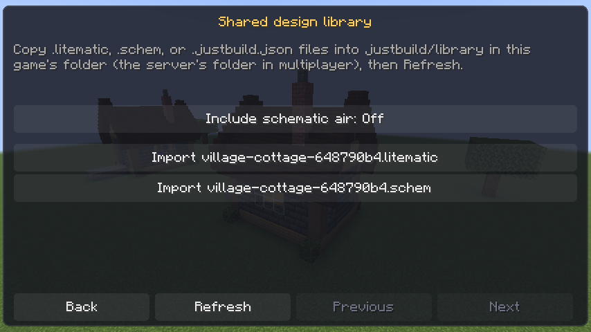

# Schematic exchange

Save a design, then choose **Export design**. For import, copy a file into `justbuild/library/` under the game folder
and open **Designs → Shared library → Refresh**. In multiplayer the directory belongs to the server. Files are
imported as owned designs; placement uses the usual preview, limits, locked areas, container protection, and undo.

| Format | Import | Export |
| --- | --- | --- |
| Litematica `.litematic` | Versions 5, 6, and 7; multiple regions and signed region dimensions | Version 7, subversion 1; one region |
| Sponge `.schem` | Versions 2 and 3 with a local block palette | Version 3 |
| JustBuild `.justbuild.json` | `justbuild-design-1` | `justbuild-design-1`, including the design folder |

Litematica support follows [maruohon/litematica](https://github.com/maruohon/litematica), including the block-state
layout in its [Fabric source](https://github.com/maruohon/litematica/blob/pre-rewrite/fabric/1.21.1-masa/src/main/java/fi/dy/masa/litematica/schematic/LitematicaSchematic.java).
Palette indices use continuous packed longs with at least two bits per cell, including indices crossing a long
boundary. Negative dimensions extend from the region position toward the negative axis. Sponge follows the
[v2 specification](https://github.com/SpongePowered/Schematic-Specification/blob/master/versions/schematic-2.md) and
[v3 specification](https://github.com/SpongePowered/Schematic-Specification/blob/master/versions/schematic-3.md),
using `x + z * width + y * width * length` indexing and unsigned varints. V3 nests its `Schematic` compound and
`Blocks.Palette`/`Blocks.Data`; v2 uses root `Palette`/`BlockData`.

Block states preserve orientation and properties. Imported air is skipped by default; **Include schematic air**
retains it for intentional clearing. `structure_void` represents unspecified gaps and is skipped. Exports include
explicit known air and use `structure_void` for unknown cells inside the bounding region. A conflicting overlap
between imported regions is rejected.

Entities, block-entity data (including container contents and sign text), scheduled ticks, and biomes do not
transfer. The importer reports omitted data when present. Unknown block states are rejected. Supported historical
block aliases resolve through JustBuild's existing block resolver; this is not a complete Minecraft data migration.
Pre-flattening numeric-ID formats, legacy `.schematic` files, and data versions newer than the running game are
unsupported. Exported files carry the running game's data version, so use a compatible Minecraft/Litematica version
to open them elsewhere.

Schematic files are limited to 16 MiB compressed, a 64 MiB NBT allocation budget, nesting depth 64, 65,536 palette
entries, 128 Litematica regions, and 1,000,000 total region cells. Every region and the combined known extent must
fit 256 blocks per axis, with offsets within ±4096. Normal plan, operation, and block limits still apply after decoding,
so the configured build limit can be smaller. JustBuild JSON retains its 2,000,000-byte limit. Library commands
accept plain filenames only and refuse symbolic-link files. The library lists at most 128 files.
Use letters, numbers, dots, hyphens, and underscores in filenames, with a lowercase extension; rename files containing
spaces or other characters before copying them into the library.

Tests include independently packed Litematica fixtures, cross-long indices, negative sizes, multi-region overlap,
Sponge v2/v3 varints, orientation/air/gap round trips, malformed input, and in-game export/import through the library.
