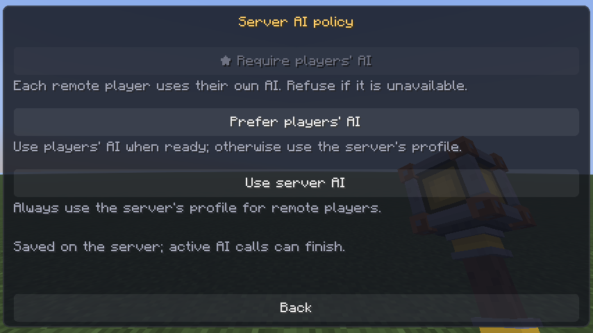
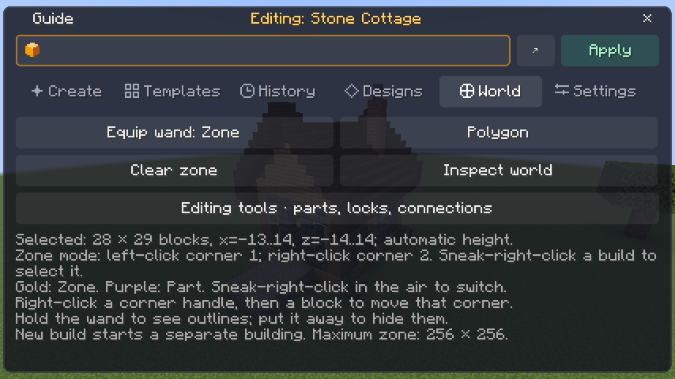
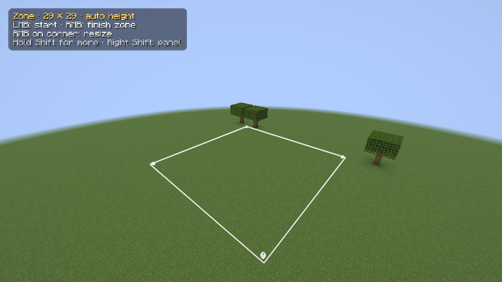
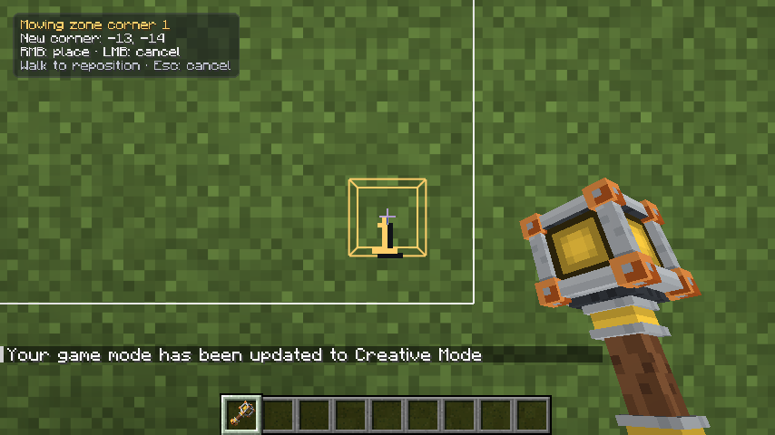
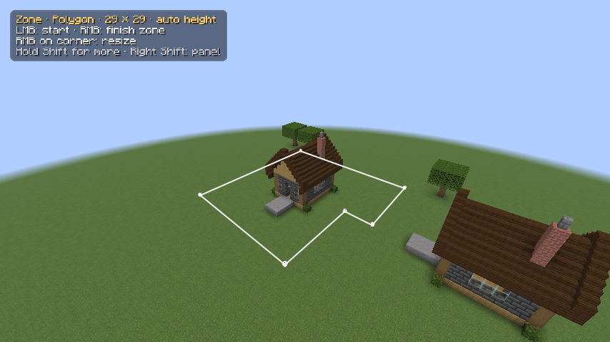
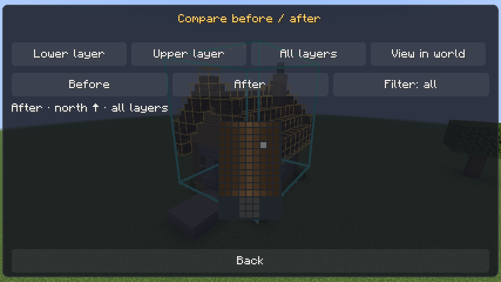
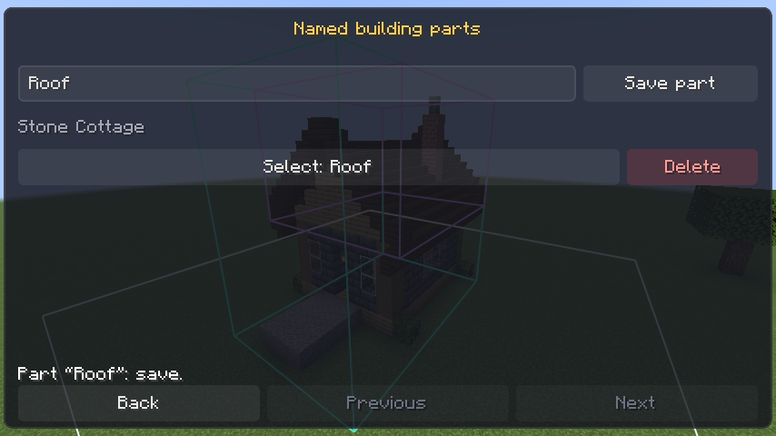
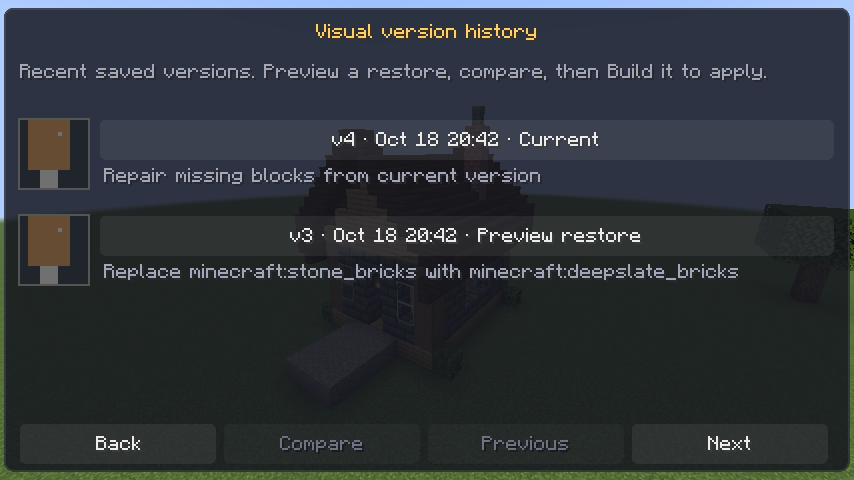
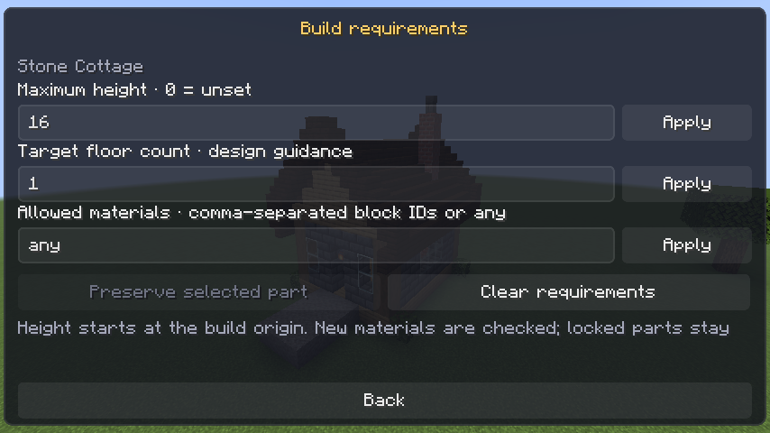
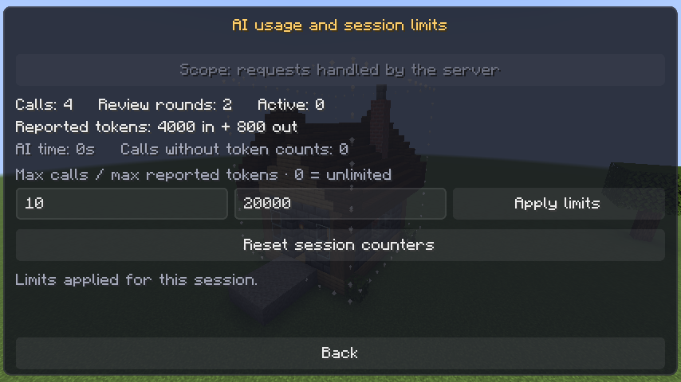

# User guide

[Back to the README](../README.md)

[AI setup](demos/12-ai-setup.mp4) ·
[Reusable prompts](demos/13-reusable-prompts.mp4) · [Cancel, retry, and undo](demos/15-cancel-retry-undo.mp4) ·
[Multiplayer](demos/22-multiplayer-ai.mp4) · [Team building](demos/23-team-building.mp4)

Detailed controls, commands, configuration, and multiplayer behavior for JustBuild on Minecraft Java Edition 26.3.
See the [installation requirements](../README.md#installation) before setting up a game or server.

- [AI providers](#backends)
- [Test and activate a profile](#testing-a-profile-before-saving)
- [Multiplayer and your own AI](#your-own-ai-on-a-server)
- [The panel](#the-panel)
- [Command reference](#commands)
- [Build zones and inspections](#build-zones-and-inspection-guided-edits)
- [Preview controls and alternatives](#preview-controls-and-alternatives)
- [Parts, locks, and connections](#parts-locked-areas-and-connections)
- [Checkpoints and saved designs](#checkpoints-and-reusable-designs)
- [Workshop](#building-workshop)
- [Storage](#storage)
- [AI guidance](#how-it-guides-the-ai)
- [Protection and previews](#safety-nets)
- [Progress reporting](#while-it-works)
- [Configuration](#config)
- [Limitations and troubleshooting](#notes)

## Backends

Install your chosen CLI using its official instructions for your operating system, then sign in as shown below.

| Provider | What it uses | Setup |
|---|---|---|
| `claude` (default) | Your Claude subscription through the `claude` CLI | Install Claude Code, then run `claude auth login` (the Claude desktop app alone is not enough) |
| `codex` | Your ChatGPT subscription through the `codex` CLI | Install the Codex CLI, then run `codex login`. |
| `grok` | Your Grok login through Grok Build CLI | Install Grok Build, run `grok login`, and select a Grok profile. **Pick…** uses `grok models`. |
| `openai` | Any OpenAI-compatible `/chat/completions` endpoint (OpenAI, OpenRouter, DeepSeek, Groq, Mistral, xAI, Gemini, Qwen, Experiential Labs, Ollama, LM Studio, …) | Fill in a profile in the panel: preset or base URL, API key, then pick a model |

Each backend is used through a **model profile**: a name, a provider, a model, and for OpenAI-compatible ones a base
URL and API key. New configurations start with four (Claude, Codex, OpenAI-compatible, Grok Build); add up to 20 profiles, for example one
per endpoint or one fast and one careful model, and switch between them in one click.
Choose the **Custom** preset to clear the base URL, then enter your own endpoint.

The mod runs the CLIs headless with host tools disabled and personal instructions, skills, and memory suppressed.
Claude keeps its existing subscription login and uses restricted/safe mode, with automatic instructions, memory,
and file attachments disabled. Codex uses an empty home and a temporary directory containing only a link to its
existing `auth.json`, with document/skill/memory loading and host tools disabled. **No second login is needed.**
Keyring-only Codex logins and systems that cannot create that link are unsupported; the request fails without
falling back to personal context.

Grok Build uses a temporary home and config, references the existing login through `GROK_AUTH_PATH`, and disables
personal context, plugins, workflows and executable planning tools. Its JSON reply appears when planning finishes.

Every request also starts with fixed rules: the AI has no host tools and must not try to access files, the network, or
your computer, and it refuses sexual content and hate symbols (it answers with a polite decline instead).

The AI never places blocks itself. It returns a JSON build plan made of shapes, and the mod validates every block id
and size limit, rotates the plan to the way you are facing, and places it over several ticks so the game doesn't
freeze. Plans support buildings, statues, portals, and sculptures made from blocks. They do not spawn mobs or run
Minecraft commands.

### Supported shapes

| Shape | Purpose |
|---|---|
| `set`, `fill`, `line` | single blocks, solid or hollow boxes, lines. `mix` (on fills, roofs, spheres, ellipsoids, and cylinders) scatters up to four other blocks through a shape, e.g. a path of stone bricks with mossy cobblestone, moss, and stone, or a rock of stone with andesite and tuff |
| `sphere`, `ellipsoid`, `cylinder` | round shapes; domes and bowls; organic bodies and heads |
| `roof` | Gable, hip, flat, gambrel, and spire roofs, with configurable pitch, trim, beams, and eaves. See roof details below. |
| `stairs`, `arch` | staircases (optionally supported) and round-topped or pointed (gothic) openings or frames |
| `voxels` | a tiny schematic (palette + text rows) for faces, logos, pixel art |
| `replace`, `foundation` | swap one block for another; fill down to the ground under a build |
| `portal` | a working nether portal (any opening from 2 × 3 to 21 × 21; the mod adds the obsidian frame and lights it) or end portal (12 frames facing the center with eyes, around a lit 3 × 3); `hollow` leaves it for the player to light. Portals are applied after every other shape, so decoration can't break them |
| `repeat`, `mirror` | modifiers on any shape: rows of windows or pillars; symmetric halves |

#### Roof details

Roofs use a stairs block with a matching slab ridge. Gable ends have a rim (barge board), with the `trim` triangle
set back beneath it; eaves use upside-down stairs underneath.

- `edge` selects a contrasting rim, ridge cap, eave, and hip-corner block, such as dark oak on a tile roof.
- `pitch: 2` builds a thick, steep roof with an upside-down stair and full block under each stair, plus a full ridge
  with a slab cap. The rim follows the profile; on 45° roofs it stands one block proud. `pitch: 0` uses a low profile
  of slabs and full blocks for temples and Mediterranean houses.
- A `spire` is a hollow tower roof that narrows one block every two to four blocks. Its `height` can be about twice
  its width, usually with a long `finial` needle.
- `flare: true` starts with a slab course that curves the eaves outward. `mix` scatters up to four other stairs
  blocks through the surface.
- `beam` adds logs along the eaves and across gables. `finial` stacks blocks, such as a fence and lantern, at the
  ridge ends. The stacks sit on the ridge.
- `rim: false` and `eaves: false` produce clean modern edges.

### World context

New builds also send the AI a height map of the ground, so builds sit on hills properly. Both builds and edits
include a fresh, read-only view of nearby blocks. The AI can ask for up to four shared spatial inspections or block-catalog lookups while planning and reviewing, through the same JSON workflow on every backend. No CLI tools are enabled.

## Your own AI on a server

Install the mod on the server **and** in each player's game. When a player runs `/justbuild`, the server builds the
request (terrain, the build being edited, questions, review rounds) and sends it to that player's game; the game asks
the player's own AI with the active profile on **their** computer and sends the plan back; the server checks it and
places it as usual. When a player's own AI handles a request, their key and login stay on their computer.
With `playerAi: prefer`, requests that fall back to the server use its configured account or API key.

- **Server setting:** open **Right Shift → Settings → Server AI…**, or run
  `/jb playerai require`, `/jb playerai prefer`, or `/jb playerai off`. Operators and the world owner can change it;
  `/jb playerai` shows the current policy. Changes save `playerAi` in the server's `config/justbuild.json` immediately
  and update every player's panel. AI calls already running can finish.
  - `require` (default): only players' own AI; players without it are told how to set it up.
  - `prefer`: players whose game is ready use their own AI; everyone else uses the server's active profile.
  - `off`: always the server's profile.

  The console, RCON, and the singleplayer owner or LAN host always use the server's profile (the host's game and
  server share one computer and one config file anyway).

  

- **In the player's game:** Right Shift → Settings shows **My profile**, **My profiles…** (the editor, working on this
  computer's `config/justbuild.json`, with Pick… asking this computer's CLI or endpoint), **Use my AI here: On/Off**, and a
  line saying which AI your builds use on this server. The game is "ready" when local AI is enabled for that server and the active profile
  works: an installed CLI, or an OpenAI-compatible profile with a model.
- **Optional response review:** **Right Shift → Settings → Review before sending** starts **Off**, including for
  existing configs. Turning it on saves `reviewAiResponses: true` on this computer for all multiplayer servers.
  Each normalized response opens a read-only viewer with its destination, request id, full response text/error,
  and token counts. **Next/Previous** or the mouse wheel page through long responses; **Copy response** copies all
  response fields. **Send to server** releases only that response; **Cancel**, Escape, or leaving the screen
  withholds it and sends a fixed cancellation with no response text or token counts. Guide requests, world
  inspections, questions, declines, plans, and self-review rounds each need their own approval. Fixed refusals with
  no AI output or usage do not prompt. A server cancellation, timeout, disconnect, or transfer discards a pending
  approval. With no more provider activity during approval, the server's inactivity timeout continues while you
  read, so a slow decision may require retrying.
  Progress counts and timing are still shared during planning. Singleplayer and server-owned AI calls do not use
  this setting. Review helps you inspect outgoing data; it does not remove the remaining channels described below.
- **Protecting your subscription from the server.** A server can't use your AI unless you turn it on for that
  server and start a build there, and then only for build plans:
  - **Off for every server** until you press **Use my AI here: On** in Right Shift → Settings while playing on it (remembered per
    server address in `myAiServers`). Until then the server uses its own profile, or refuses if it requires players'
    own AI.
  - **Only builds you start.** An AI-starting `/justbuild` (a description, `edit`, `template`, `again`, `answer`) allows
    twelve AI calls within a 15-minute inactivity window (a guide request, up to four shared spatial/catalog reads, a plan, up to two tries at a smaller plan,
    up to two review rounds, and bounded headroom). An `alternatives` command allows twelve calls per requested option,
    still within the 30-per-hour ceiling. Chat renews only as the answer to a question your AI just asked. A button in
    a server line shown in the panel never starts one; use the panel's own answer buttons and Templates tab, or type
    the command.
    Each build you start shows "(your game) Planning “…” with your …"; anything else is declined with a
    "(your game)" line.
  - **Data, not instructions.** The server sends the request as data. Your game checks that the request is something
    you typed (or a template you picked), that questions are ones your AI asked and answers ones you gave, that ids,
    styles, creative directions, and guide ids are known values (guide texts come from your game's own copy), that
    block names in world samples, palettes, and block lookups are blocks your game has, and that
    plans parse (they are re-written from what was parsed). Then it writes the instructions (the same safety rules as always), the request text, and the build-plan
    format itself, with every CLI tool still disabled.
  - **Responses are normalized.** Your AI's answer is re-written as a build plan, a short question, a fixed decline,
    known guide ids, or a bounded box to inspect. Titles are limited to 60 characters, summaries/questions to 240,
    and up to four answer choices to 60 each. Decline explanations and provider/parser diagnostics stay in your
    game; network errors use fixed text. Progress still includes bounded counts and timing.
  - **What's left**, for a server you turned it on for: it gets build plans for what you start there; an edit request
    carries up to 10 build-history texts (600 characters each) that the server supplies. Permitted response text and
    valid geometry/material choices can still encode information; length limits do not make secret-bearing output
    safe. Only turn it on for servers you trust.
- Permissions are unchanged: `/justbuild` is for ops and the singleplayer owner.

## The panel

Cobble, your little builder robot, visits the active worksite while the AI plans or places blocks. He walks around its edges, stops to
hammer, and idles while a question or preview waits for your response. He leaves when the work finishes or is
cancelled. Nearby players with the mod can see him; his animation does not change blocks or collide with players.

Use **Guide** at the top of the panel for a four-step walkthrough: choose an AI and test its connection, select an optional
work area, write a request, and inspect its preview before choosing **Build it**. An empty Create tab also offers
**Start your first build**. The guide reflects current state and warns when Auto-build is enabled; navigation never sends
a planning request.




Press **Right Shift** (rebindable under Controls → JustBuild) to open the panel, a glass sheet over the game that hides the HUD
(except subtitles) while open; **×** or Esc closes it. It doesn't pause the game, so builds keep going while it's open.
Two more keys, unbound until you set them, build or discard a waiting preview without opening the panel.

- **Create:** type a request and press Enter or **Build**. A line under the tabs says what the next request does: a new
  build or editing the selected one, inside which zone, and how many options. When a build is selected, **Apply**
  edits it; each building keeps its own draft on this computer. **New build** leaves editing mode (and drops the area that
  came with the last build, keeping a zone you drew yourself). While the AI waits for an answer, the button becomes
  **Answer** and the AI's options become buttons. Sending a new request while one is planned stops the earlier one
  and says so. Text that begins with `/` in the compact box runs as a single-line command.
  Multiline drafts appear as a read-only preview in this compact box; edit them with **↗** to keep line breaks.
  Use **↗** beside the box for the multiline editor, with a visible count up to 4,096 characters. Enter adds a line;
  Ctrl+Enter sends. **Save prompt** keeps reusable text on this computer, and **Reuse prompt…** puts it back in the
  editor for you to change or send. Up to 20 prompts are saved in `config/justbuild-prompts.json`. Drafts remain in
  memory for up to 64 build/world contexts until the game closes; they are separate from saved prompts.
  The bottom row follows what's waiting: **Build it** for a preview, **Confirm undo** for an undo, **Discard** or
  **Stop request**, and **Undo** names what it would undo. Build and confirmation buttons share the same mint styling.
  Buttons in the panel's messages can be clicked. A
  rejected or discarded plan gets **Retry saved plan** (no new AI call) and **Wand: Zone** to move corners before retrying. **Workshop** is here too.
  While a preview waits, its dimensions and full-plan add/replace/remove counts stay visible. **Checks** opens its
  warnings; **Before**, **After**, and **Show** control the comparison, including the floor view. The selected
  alternative is highlighted and numbered. All controls are reachable with Tab and Enter.
- **Templates:** 24 ready-made requests in 6 categories (homes, castles, villages, nature, fantasy, monuments). Click
  one to put it in the request box, tweak it if you like, then Build.
- **History:** select a recent build with **Edit** or its name to load its saved area. **Manage** opens naming,
  checkpoints, and **Save design**. The Create tab also has **Manage build** for the current selection.
- **Designs:** place saved copies, rotated by 0°, 90°, 180°, or 270° from your facing. **Swap materials…** picks a
  block to swap out and its replacement with the block picker. Copies always preview and make no AI call.
- **Workshop:** open **Create → Workshop**, **Editing tools → Workshop**, or **Manage build → Workshop** to add existing builds,
  swap materials, repair damage, plan interiors, manage village projects, and check walkability. Tools are grouped
  into **Build & edit** and **Inspect & protect**. Hover a tool for its keyboard shortcut.
- **World:** equip the Zone wand, draw a polygon, clear the selection, or inspect the world without calling
  the AI. Move corners directly with the wand’s in-world handles. The white outline marks the selected footprint and any height bounds. Locked areas are outlined in blue.
- **Settings:** the active profile, AI review, style, and model (**Pick…** lists the models the profile offers),
  plus Doctor, Reload, and **Server AI…** to choose the player AI policy. **Doctor** opens a scrollable results dialog
  that updates as each server profile finishes its install, login, or endpoint check. Scroll with the mouse wheel,
  drag the scrollbar, or focus the results and use the arrow/Page Up/Page Down keys. **Copy results** copies the report.
  **Auto-build** is your own choice: when on, AI results place as soon as they're ready,
  without Build it (undo still works; alternatives, saved plans, and design copies still preview). **Manage profiles…** opens the profile editor:
  - the profiles on the left (★ is the one builds use) with New, Copy, and Delete;
  - name, provider, and model (**Pick…** asks the backend: Codex via `codex debug models`, Grok Build via `grok models`, OpenAI-compatible via
    `GET /models` with that profile's key, Claude from a built-in list because its CLI cannot list models);
  - for OpenAI-compatible profiles, a **Preset** button that fills in the base URL of a known service, the base URL,
    and the API key (hidden as `*` unless you press Show; leave it blank to keep the saved key, Clear removes it; a
    saved key is dropped if you change the base URL, so it can't be sent to another host);
  - for OpenAI-compatible profiles, **Reasoning** (Endpoint default, None, Low, Medium, High), sent as
    `reasoning_effort`. Thinking models may spend a long time reasoning before writing a plan. None requests no
    reasoning where supported; available settings depend on the model and endpoint. Endpoint default leaves the field out;
  - **Save** (green; saves edits while builds keep using ★) and **Cancel**. Return to Settings and click **Profile**
    (or **My profile** on a remote server) to switch the active profile. An
    OpenAI-compatible profile needs a model before it saves, and Cancel asks again before dropping unsaved changes.

  In singleplayer and as LAN host the editor works on the world's server: API keys go to it as a packet, never as a
  command (command text ends up in logs: Fabric writes it to the game's `debug.log`), and are never sent back to the
  game; only ops and the singleplayer owner can edit. On a server your game doesn't host, the editor works on this
  computer's profiles instead, and keys never leave your computer.

On a server your game doesn't host, Settings shows your own AI instead (see above). Everything else the panel does
is an ordinary `/justbuild` command, so it works from chat too.

## Commands

The main command is `/justbuild`. `/jb` is a full alias, including help, build descriptions, and every subcommand
listed below. Enter `/justbuild` or `/jb` alone to show help.

Type **`/justbuild help`** (or just **`/justbuild`**) for the full command reference in chat. Click **Next** / **Previous**
to turn pages, or **Topics** to browse one command family. For example, `/justbuild help zone` shows zone commands and
`/justbuild help zone 2` opens its second page. Clicking a command fills the chat input so you can edit it before sending.
`<angle brackets>` mark required values; `[square brackets]` mark optional ones.

To prepare a new building from chat, use **`/justbuild new`**, draw its zone with the wand, then send
**`/justbuild build <description>`**. `new` matches the panel's **New build** button: it leaves editing mode, clears an
area loaded from the previous build, and keeps a zone you drew yourself. `build` always starts a separate build.

| Command | Purpose |
|---|---|
| `/justbuild help [topic\|page] [page]`, `/justbuild help topics` | Browse every command and its description, or one command family |
| `/justbuild new` | Leave editing mode to prepare a new building; same as the panel's New build button |
| `/justbuild <description>` | Plan and build inside your selected zone, or otherwise in front of you / at the spot you're looking at if it's 6+ blocks away |
| `/justbuild build <description>` | Explicit new-build request; works even when the description begins with a command word such as “design” |
| `/justbuild zone wand` | Equip the Builder Wand in gold Zone mode: left-click a block for corner 1, right-click another for corner 2 |
| `/justbuild zone 1`, `/justbuild zone 2` | Select opposite ground corners using the block under your crosshair (or underfoot); optional `x y z` coordinates are accepted |
| `/justbuild zone expand [blocks]` | Grow every edge of the selected footprint by this many blocks (default 4) |
| `/justbuild zone include` | Expand the footprint to include the block under your crosshair, or underfoot |
| `/justbuild zone`, `/justbuild zone clear` | Show the current footprint or clear it |
| `/justbuild zone adjust move <dx> <dy> <dz>` | Move the selection, up to 16 blocks per axis per command |
| `/justbuild zone adjust height <minY> <maxY>` | Set inclusive vertical bounds; `height auto` removes them |
| `/justbuild zone adjust corner <index> <x> <z>` | Move a rectangle corner or polygon vertex; indices start at 0 |
| `/justbuild zone adjust polygon <start\|add\|undo\|finish\|cancel>` | Draw a polygon using the wand or the current target |
| `/justbuild inspect` | Summarize loaded block states in the zone, at the spot you point at, or around a build you point at; no AI call or block changes |
| `/justbuild confirm` | Place the waiting preview (or click `[Build it]`); undo has its own confirmation command |
| `/justbuild preview discard` | Discard only the waiting build preview, keeping its plan available for Retry |
| `/justbuild preview move <x> <y> <z>`, `/justbuild preview rotate <degrees>`, `/justbuild preview snap` | Move a new-build or copy preview, rotate clockwise by 90/180/270°, or snap its origin to the ground; no AI call |
| `/justbuild alternatives build <2\|3> <description>`, `/justbuild alternatives edit <2\|3> <change>` | Generate separate options; all wait for your choice and confirmation |
| `/justbuild preview option <number>` | Switch between completed options without another AI call |
| `/justbuild select` | Select the saved building under your crosshair, up to 64 blocks away |
| `/justbuild select #<id>`, `/justbuild select clear` | Select a build and load its saved area; leave editing mode while keeping the current zone |
| `/justbuild rename <name>` | Name the selected build (1 to 60 characters); edits keep the name |
| `/justbuild edit <change>` | Edit the explicitly selected build; `edit #<id> …` targets a build while keeping your current zone |
| `/justbuild box wand`, `/justbuild box 1`, `/justbuild box 2` | Equip the Builder Wand in purple Box mode; `1` starts a selection and each `2` grows it to include another point. Optional `x y z` coordinates work with both commands |
| `/justbuild box <roof\|wall\|room>`, `/justbuild box clear` | Suggest a part of the selected build, or clear the focused edit area |
| `/justbuild box <save\|select\|delete> <name>` | Save, reuse, or delete a named selection on the selected building |
| `/justbuild box adjust <move\|min\|max> <x> <y> <z>` | Move the box by offsets, or set either corner to absolute coordinates |
| `/justbuild box adjust corner <index> <x> <y> <z>` | Move one of the eight box corners while keeping its opposite fixed; indices start at 0 |
| `/justbuild constraints <height\|floors> <number>` | Enforce maximum height or request a target floor count; 0 unsets it |
| `/justbuild constraints materials <IDs\|any>`, `/justbuild constraints clear` | Restrict new materials with comma-separated block IDs, or clear requirements |
| `/justbuild history preview <version-id>` | Preview a saved version of the selected building; confirm to restore it |
| `/justbuild quality repair <issue-id>`, `/justbuild quality revert` | Preview a repair from Checks, or revert that suggestion |
| `/justbuild usage <max-calls> <max-reported-tokens>` | Set limits for server-handled requests this session; 0 is unlimited |
| `/justbuild usage show`, `/justbuild usage reset` | Refresh usage or reset idle session counters |
| `/justbuild lock <name>`, `/justbuild lock`, `/justbuild unlock <id>` | Persist the selected part as a protected area, list your locks, or remove one (the console and admins can remove any) |
| `/justbuild link a [id]`, `/justbuild link b [id]`, `/justbuild link clear` | Pick two saved buildings, using the selected build when no id is given |
| `/justbuild connect <description>` | Preview a separate path, bridge, fence, or landscape connecting the two buildings |
| `/justbuild retry` | Preview a retained plan without another AI call: one that crossed the zone (after enlarging it), or one that finished after you left its area (after returning) |
| `/justbuild checkpoint save <name>`, `/justbuild checkpoint restore <name>` | Save the selected build's plan as a named checkpoint; preview restoring it as an undoable edit |
| `/justbuild checkpoint` | List checkpoints for the selected build |
| `/justbuild add <name>` | Add the part-wand selection as an editable build without changing blocks; save its original checkpoint |
| `/justbuild materials`, `/justbuild materials sample` | Refresh the selected building's palette or sample the block under the crosshair |
| `/justbuild materials replace <from> <to>` | Preview a material swap, preserving compatible block properties |
| `/justbuild materials reroll [seed]`, `/justbuild materials weight <block> <0..100>` | Preview a local material-mix change with a reproducible seed or relative weight; no AI call |
| `/justbuild repair missing [checkpoint]`, `/justbuild repair all [checkpoint]` | Compare live blocks with the current version or a checkpoint; preview a local repair |
| `/justbuild interior <home\|workshop\|tavern\|custom> <complete\|layout\|furnish> [details]` | Plan a purpose-specific interior within the building's shell |
| `/justbuild project create <name>`, `/justbuild project select <id>`, `/justbuild project clear` | Create or select a village project, or leave project mode |
| `/justbuild project add`, `/justbuild project remove`, `/justbuild project list` | Manage the selected build's membership or list projects |
| `/justbuild project style <style>`, `/justbuild project palette <ids\|building\|clear>` | Set a shared style and up to 12 comma-separated block ids, or use the selected building's palette |
| `/justbuild project invite <player>`, `/justbuild project uninvite <player>`, `/justbuild project leave [id]` | Co-building: the project's owner adds or removes a player (their name if they're online or joined this server in the last month, otherwise their UUID), who may then change every building in the project; a collaborator can leave |
| `/justbuild release #<id>` | Stop another player's waiting edit or preview on a build you own (or a build in your project, or as an admin) |
| `/justbuild walkability`, `/justbuild walkability clear` | Check the pending preview or selected building and show or clear route markers |
| `/justbuild design save <name>`, `/justbuild design list` | Save the finished build as a reusable design; list your designs and their ids |
| `/justbuild design place <id> [rotation] [from=to,...]` | Preview a copy here, with optional clockwise rotation and material swaps |
| `/justbuild autobuild [on\|off]` | Your own setting: place AI results as soon as they're ready, without a preview |
| `/justbuild design folder <id> [name]` | File a saved design in a folder; omit the name for Unfiled |
| `/justbuild design export <id> [litematic\|schem\|justbuild.json]` | Export a design; defaults to JustBuild JSON |
| `/justbuild design import <file> [air]`, `/justbuild design refresh` | Import from the shared library, optionally retaining schematic air, or refresh the file list |
| `/justbuild templates [filter]`, `/justbuild template <id>` | List the ready-made requests; build one |
| `/justbuild history`, `/justbuild again #<id>` | Your recent builds; rebuild one's original request |
| `/justbuild detail <quick\|detailed\|masterpiece>` | AI review: quick = When needed, detailed = One pass (default), masterpiece = Two passes |
| `/justbuild style <auto\|medieval\|modern\|futuristic\|japanese\|nordic\|steampunk\|rustic\|fantasy\|gothic\|desert\|classical>` | A style and suggested palette; auto lets the AI interpret the request without adding a preset |
| `/justbuild answer <text>` | Answer the AI's question. You can also type the answer in chat or click an option. |
| `/justbuild undo` | Undo your last action: an edit goes back one version, a new build is removed (10 steps). Shows what will change and asks you to confirm first. Run it near the build, in its dimension |
| `/justbuild undo confirm`, `/justbuild undo cancel` | Confirm or cancel a pending undo |
| `/justbuild cancel` | Stop a request or a build in progress |
| `/justbuild profile [name]` | List AI profiles (click `[Use]`); add a name to switch to one |
| `/justbuild model [name\|default]` | List the active profile's models; add a name to choose one, or `default` to reset |
| `/justbuild provider <claude\|codex\|grok\|openai>` | Switch to the first profile using that backend (adds one if none does) |
| `/justbuild playerai [require\|prefer\|off]` | Show or change the server's player AI policy; `require` is the default |
| `/justbuild status`, `/justbuild doctor`, `/justbuild reload` | Status, check every profile's install, login, or endpoint, reload config |

Works for the singleplayer world owner (cheats not required), the LAN host, and ops.
The older `/justbuild profiles` and `/justbuild models` spellings remain aliases for the singular list commands.

## Build zones and inspection-guided edits

The **Builder Wand** arrives automatically when you join a world where you have JustBuild permission
(singleplayer owner or server operator), and after respawning if it is missing. It is **gold in Zone mode**
and **purple in Box mode**; its name also shows the mode. **Sneak-right-click in the air** to switch modes.
Switching modes preserves both selections. Sneak-right-click on a saved building still selects it for editing.
Existing zone and part wands in your inventory combine into one Builder Wand when you join or equip it.
Automatic delivery keeps your selected slot and other items intact. If your inventory is full, it waits for room.
It does not keep replacing a wand you deliberately put away or drop during that session.

Open **Right Shift → World → Wand: Zone**, or run `/justbuild zone wand`, to equip the wand in Zone mode.
Left-click a block for corner 1, then right-click another block for corner 2. The wand reaches up to **64 blocks** and
leaves the blocks intact, including containers. Requesting either mode reuses the same wand. If you lost it,
the panel can supply a replacement when you have room. Selecting corners and switching modes do not call the AI.
Zone, part, and corner-handle outlines use anti-aliased edges to keep diagonal lines smooth.
The white zone outline is visible only while you hold the wand in either hand. Put it away to hide the outline;
the selected zone still limits builds and edits. Use **Clear zone** or `/justbuild zone clear` to remove the selection.
You can also use `/justbuild zone 1` and `/justbuild zone 2` in chat. These are inclusive X/Z corners,
up to 256 × 256 blocks. Their Y coordinates set the ground reference; height is unrestricted unless you set bounds.

The selected build has a teal outline labeled **Editing** while you hold the wand. Purple marks the selected edit part;
blue marks protected areas that stay unchanged. With the wand put away, a small HUD keeps the selected build or waiting
preview visible. Clear the build selection to leave edit mode.

While holding the wand, a compact, translucent HUD shows the mode, selection dimensions, selected building, and
your actual bound keys. Hold **Sneak** (normally Left Shift) to see the select-build, switch-mode, and clear-part
shortcuts. Mouse buttons are abbreviated **LMB** and **RMB**; rebound keys keep their own names.
**Right-click a corner handle**, walk to a new spot, then right-click a block to place that corner. The existing
handle and outline move together: purple for parts, white for zones. The target block is highlighted purple in Part
mode and yellow in Zone mode, at both close and long range. Zone handles sit just above the ground reference
plane; picking up either kind of handle keeps the selection still until you change your aim or position. The destination can be up to 64 blocks away. Left-click or press Esc to cancel. This works for rectangular zones, polygon
vertices, and all eight part corners; zone height stays unchanged. An invalid position turns the held handle red and keeps the last valid
shape, so you can choose another spot. Cancelling restores the original outline. For exact coordinates, movement offsets, or height bounds, use
the `/justbuild zone adjust` and `/justbuild box adjust` commands listed above. Height bounds are inclusive world Y
coordinates; `/justbuild zone adjust height auto` removes them.





For an irregular plot, choose **World → Polygon → Start polygon with wand**. Left-click starts again;
each right-click adds a vertex in boundary order. **Undo last corner** removes a mistake, and **Finish polygon**
closes the shape. Use 3–32 distinct corners without crossing edges. Concave plots are supported; blocks in a notch
stay outside the zone. Edit individual vertices to resize a polygon. Uniform expansion controls apply to rectangles.
Drawing begins with your first click. Cancel restores the previous selection without changing the building's saved
area; finishing keeps any existing height bounds in the same dimension.



New builds use the center of the footprint and the ground height there. In the Nether that is the cavern floor nearest
the corners you chose, not the top of the bedrock roof. Ordinary block and size limits still apply.
Use `/justbuild zone expand 8` to add a custom amount on every edge. `/justbuild zone include` grows just enough to
include the block you point at, falling back to underfoot. Expansion
keeps the entire old footprint, stays within 256 × 256 blocks, and updates the outline immediately. It does not move
existing builds; subsequent edits keep their original origin.
A zone is personal and belongs to its dimension. Each build remembers its area in the world save. While editing a
selected build, finishing a new footprint, expanding it, or clearing it updates that saved area. Choose **New build**
before drawing an area for another house. The active selection clears when you leave; selecting the house again loads
its saved area. Finish or cancel any request, preview, or placement before changing it.

**Sneak-right-click a saved build with the wand** to select it, or use **Right Shift → History → Edit**. The panel shows the
selected name. The wand recognizes the building even when the clicked block is outside its saved zone.
If no building is selected and you have drawn a complete zone containing that block, wand selection keeps your drawn
zone and saves it for the building when you have permission to edit it. Otherwise it loads the building's saved zone;
use the wand's corner handles to resize it. Selecting from History or by id always loads the saved zone.
Selection does not fall back to the latest build; `/justbuild edit …` needs a selection or an explicit id.

The zone also guides edits: select the house first, then draw a footprint around the portion you want to change and
use `/justbuild edit …`. Include the connecting wall when adding a room. The AI gets the
saved plan plus fresh samples from the world, including block states and their positions. It can ask for a smaller
box to inspect when it needs more detail, then returns the complete revised plan. For example, `edit add windows
facing the path` can use the current surroundings, and a later `edit replace the gold trim with copper` inspects the
build again. Only the difference between plans is applied; unchanged parts outside the zone are allowed. This edits
managed builds, including structures you built by hand. It does not automatically repair manual changes to
unchanged plan cells; use the repair tools for that.

Every snapshot reads only loaded blocks on the server thread and never forces chunks to load. The AI can request
sampled regions, exact regions of up to 4,096 cells, or column surface surveys of up to 32,768 cells, from either the
original world or a checked candidate. A surface survey reports the top block, first solid support, liquid above it,
and headroom within the requested height range. Unknown cells and unsampled gaps are not air. Block lookups return
paged registry IDs or the valid properties and default state of one block. All spatial and catalog reads share a
four-request budget per conversation; they can be used during review as well as initial planning. Each read causes
another model call. An oversized exact read returns feedback asking for a smaller region. A candidate becomes
available after the first draft. Clarifying answers do not reset the read budget; size retries cannot request reads.

The mod also creates original/candidate PNGs from bounded snapshots of up to 32,768 cells. These show simplified
block colors in isometric, top, and central-section views, with bounds and sample spacing. They are aids to review,
not textured Minecraft screenshots or proof of walkability. The player's client reconstructs images and diagnostic
text from validated data when using a personal AI on a server. Samples and images go to your chosen provider;
chest contents, sign text, books, entities, and other block-entity data are excluded. Compatible endpoints that reject
image input fall back to text views and diagnostics. `/justbuild inspect` only shows a local summary.

The mod rejects an entire generated plan or edit diff that crosses the footprint, including clearing, foundations, and
completed bed halves. It keeps that plan for 30 minutes in the current session: enlarge the area, then **Retry saved
plan** or `/justbuild retry`. Retry revalidates the original plan at its original position, always previews, and does not
call the AI. A plan that finishes after you leave its area, by walking away or going through a portal while the AI
works, is kept the same way: the message names the dimension to return to, then retry. A changed source build makes
the retained edit stale; a new request, Cancel, or disconnect discards it.
Confirmation checks the boundary again. Undo also respects the current zone; clear or enlarge
it to undo a larger area. Undo runs in the build's own dimension once all of it is loaded; since it steps back
through your latest change first, it tells you where that build is when you are somewhere else. The footprint bounds JustBuild's direct block changes; normal Minecraft physics can
still affect neighboring blocks.

## Preview controls and alternatives

[Watch the close-up: move, cancel, and build in the world](demos/24-in-world-controls.mp4).

Controls float at the base of a waiting preview, along the side nearest you: look at one and right-click it (no tool needed; the click does nothing
else). Floating controls and labels have dark drop shadows for contrast against the world.
A control turns yellow and gains brackets when you aim at it. The mint **Build it** places the approved preview;
**Discard** cancels the waiting preview without placing blocks. Both are always there; with alternatives,
**◀ Option 2 of 3 ▶** switches between them.
New builds and design copies also get a compact directional pad: **◀** and **▶** sit beside **▲** (away) and **▼**
(toward you), and each moves the preview one block. **Up**, **Down**, **Rotate**, and **Snap** (onto the ground at its origin)
sit with the other controls at the base; arrows, Up, and Down step five blocks while sneaking. The controls show within about 64 blocks of the preview, hide while the JustBuild
panel is open, and make no AI call. Preview Build/Discard controls never confirm an undo or cancel a separate
request. The optional build/discard keybindings operate only during gameplay with a preview in the current dimension.
Every adjustment rechecks the zone, loaded chunks, height, limits, and locked areas; a rejected adjustment keeps the
previous preview. Edits stay anchored to the existing building; save a design to move or rotate a copy.

While a preview waits, **Right Shift → Create** also shows **Checks (N)** and **Floors**. **Checks** lists possible blocked
doorways, stairs without clear landings, floating sections, and uneven foundations. These are advisory: decorative
stairs, floating builds, and stepped foundations can be intentional. A warning makes a new build wait for
confirmation unless Auto-build or direct placement with `previewAbove: -1` is enabled.

Each located warning has **Highlight location** and, where a local repair is available, **Preview repair**.
Suggestions clear door/stair obstructions or add short supports down to solid ground, up to 16 blocks below.
They obey the zone, selected part, locks, other buildings, container protection, and build requirements. A rejected
suggestion keeps the preview unchanged. **Revert repair suggestion** returns to the original proposal; **Build it** applies
the chosen preview. These tools make no AI call and do not guarantee that a structure is architecturally correct.

**Floors → Before / After** compares current blocks with the proposed result in a top-down section. Cycle **Filter**
through all, added, replaced, and removed changes. The same filter applies to world ghosts; Before hides ghosts to
show the current world. A fresh preview resets the comparison controls. The section includes known building cells
and affected positions, not every surrounding world block.



Choose **Options: 2** or **Options: 3** on Create before submitting a build or edit. The AI plans each option in
sequence, with separate model calls and normal review rounds. Nothing is placed during generation. Once ready,
switch with **◀ ▶** at the base of the preview (or `/justbuild preview option <n>`), then **Build it** to apply only the
displayed option. Moving a preview or switching options makes no additional AI call. If a later option fails,
completed options remain available.

## Parts, locked areas, and connections

Select a saved building, then open **Right Shift → Editing tools → Parts**. **Roof** suggests its upper section; **Wall** selects
the vertical plane of the side you point at; **Room** finds an enclosed air space beside the surface you point at
and includes a one-block shell. Check the purple box before editing. **Wand: Box** equips the same Builder Wand in purple Box mode
using [WorldEdit-style Extend selection](https://worldedit.enginehub.org/en/latest/usage/regions/selections/#selection-modes):
left-click starts a new selection; each right-click grows the box to include that block. Start with a bottom corner,
right-click the opposite footprint corner, then right-click the roof to include its height. Keep right-clicking to
include missed edges. A point outside the footprint also expands it horizontally. The purple outline appears from
the first click; its size updates as you add points. Once the box is selected, **eight purple corner handles** let you
resize it: right-click a handle, then right-click a block at its new location. This can shrink or grow the box in all
three axes while keeping the opposite corner fixed. Left-click or Esc cancels the move. Even a flat selection has
separate upper and lower handles, so you can adjust its height. When no corner is picked up, left-click starts a new
selection. Open or large rooms need manual selection. An edit changes only
the selected part within the build zone, even if the AI revises other parts of the plan. **Sneak + left-click** while
holding the wand in Box mode clears the active box; it works when aiming at a block or empty air.
The HUD shows your bound controls. **Clear box** in the panel and `/justbuild box clear` do the same thing,
restoring editing across the build area. Saved named parts remain available. These tools apply to saved builds,
including structures you built by hand.

**Named parts** saves the current box under a name such as Kitchen, East tower, or Roof. A building can retain 32
named parts; selecting one restores that exact world-space box for later edits. These names persist with the building
and are available to authorized collaborators. Saving a part does not lock it. Move its corner handles with the
wand, then save again to update the named box.



To preserve a detail, select part corners around it and open **Locked areas → Lock area**. Locking clears the focused
selection so later edits can change the surrounding building. Locked blocks are excluded from AI builds, edits,
copies, checkpoint restores, undo, and cancellation reverts. Locks persist in the world and apply to every builder;
each player can unlock their own areas. The limits are 32 per player and 128 per world. Purple part outlines and
blue lock outlines appear while holding the wand. Locks protect JustBuild's changes; ordinary gameplay and world
physics still work. If the saved lock file cannot be read, placement pauses until it is repaired and reloaded.

Under **Editing tools → Connections**, choose your two buildings as **A** and **B**, then select Path, Bridge, Fence,
or Landscaping and describe the result. The mod gives the AI both buildings' positions and a view of the ground
between them, with **12 blocks of extra room on every side** for bends, landings, and verges. Paths and bridges
are instructed to come straight out from **both entrances for at least five blocks before turning**, then join
those approaches with bends while following the ground height. Existing approaches or your explicit instructions
can override that layout. If the entrances are unclear, the AI can inspect more closely or ask you. The mod
protects both buildings and creates the connector as an independent, editable, undoable build.
The connector previews unless you enabled Auto-build.
Both buildings must be in the same dimension and fit together inside a 256-block-wide footprint with its margin.

## Checkpoints and reusable designs

Use **Manage build** to rename the selection, save a checkpoint such as “Original house,” or save a design.
Checkpoints preserve the saved plan, independently of later undo steps (up to 32 per build). Restoring one previews
the difference and creates a new version, so you can undo the restore. Changes still obey the selected zone and
existing protection for containers and other blocks holding player data.

**Workshop → Version history** shows thumbnails of up to 32 recent retained versions. Choose **Preview restore**,
then **Compare** to inspect before/after changes. **Build it** creates a new undoable version. Original plans and
versions needed by another player's undo history are retained separately; versions already pruned by older releases
cannot be recovered by this screen.



Designs are stored separately from their source build (up to 64 per player in each world). Saving captures the live
block states at that build's known positions, including manual material changes there, in its original coordinate
frame. Unknown gaps stay untouched. It does not capture additional blocks outside those positions, entities, chest
contents, or sign text. Select **New build**, set the destination area, then choose a saved design under **Designs**.
Rotation also rotates stairs, logs, and other directional states. Material swaps preserve state properties and reject
incompatible replacements. The copy gets its own id, saved area, edit history, and undo step.

The **Designs** tab includes top-down color thumbnails, a name search, and a folder filter. Open a design to set its
folder or **Export design**. **Shared library** imports portable designs from `.minecraft/justbuild/library/`, which
is shared by worlds in that game installation. Export in one world and import in another, or copy a `.litematic`,
`.schem`, or `.justbuild.json` file into that folder and press **Refresh**. In multiplayer this is the server's folder;
the panel does not upload files from a player's computer. Import creates a new owned design, validates its blocks
and limits, and adds a suffix to duplicate names. JustBuild JSON also retains its folder. These actions use no AI calls.

**Export design** offers Litematica, Sponge schematic, and JustBuild JSON. Schematic imports skip air unless
**Include schematic air** is on. Air can clear blocks when the design is placed; unspecified gaps remain untouched.
Only block states transfer: entities, container contents, sign text, ticks, and biomes are omitted. Unsupported blocks
or newer Minecraft data versions are refused. See [schematic formats and limits](schematic-formats.md).

## Building workshop

Open **Editing tools → Workshop** or **Manage build → Workshop**.


**Requirements** applies to the selected building, or becomes your saved defaults for new builds when no building
is selected. Maximum height is measured upward from the build origin (1 permits only the origin layer); foundations
below the origin remain allowed. The allowed-material list restricts new or replaced non-air blocks while preserving
unchanged existing materials. Both restrictions are checked before placement, including local swaps, copies, and
repairs. Floor count is AI design guidance, not an automatic floor-count guarantee. **Preserve selected part** opens
the existing locked-area controls. Finish or cancel active work before changing requirements.



- **Add existing build:** use **Wand: Box**, left-click a bottom corner of a hand-built structure, then right-click
  to include the opposite footprint corner and the roof. Add more points until the purple box surrounds the whole
  structure, then name it. Adding a build saves its current blocks and an **Original building** checkpoint without placing anything. Future
  edits work like other saved builds; undo cannot remove the original building. Containers, signs, other block-entity
  positions, and locked areas are excluded. Selections cannot overlap an existing saved structure and must fit the
  configured block limit (`maxBlocks`, 250,000 captured positions by default).
- **Materials:** choose a source from the building's block-icon palette, then search the visual block picker for a
  replacement. You can also point at a world block, choose **Sample world block**, and reopen Materials to use it.
  The preview affects matching live blocks at known positions inside the current build zone and selected part,
  preserves compatible stairs/log properties, and respects locks. Matching blocks outside the zone stay unchanged.
- **Repair:** compare live blocks against the current version or a named checkpoint. **Missing blocks only** fills
  air gaps while preserving manual material changes. **All differences** also replaces changed materials and clears
  positions the chosen snapshot records as air. Repairs stay inside the box and zone and respect locks.
  Both repair and material swaps use no AI and save their actual previous blocks, so undo restores the damage or manual materials.
- **Plan interiors:** choose Home, Workshop, Tavern, or Custom and optional details. **Complete** plans rooms and
  furnishing; **Layout** and **Furnish** let you split that into separate undoable passes. The AI receives instructions
  for lighting, doors, stairs, and clear routes. Changes are limited to the building's bounding box inset by one block
  on every side, intersected with an existing box. Check the preview for irregularly shaped buildings.
- **Village projects:** group existing builds or let new buildings, saved copies, and connections join the active
  project. Set a shared style and palette for AI requests. Use Connections for paths, bridges, fences, and landscaping
  between buildings, or New building for other outdoor work. Buildings retain independent versions and undo.
  Projects persist per world and dimension; there are up to 32 per player and 128 members per project.
  **Co-building:** in Project settings → Team, the project's owner invites up to 16 players. The owner and the team
  may change every building in the project (edit, rename, checkpoints, repair, materials, interiors); each player's
  undo steps stay their own. Only a building's owner or an admin may share it with a project; the project owner may
  also remove it. A teammate cannot move somebody else's build into another team. Uninvite or Leave immediately
  cancels work that lost permission, including waiting previews and queued edits. Overlapping cells of other
  protected builds stay protected even when you own the build being placed or undone. The build owner, project
  owner, or an admin can **Release** another player's waiting edit; work already placing must finish or be cancelled
  by its actor. Project membership does not grant access to another player's locks.
- **Texture controls** in Materials reroll existing procedural mix palettes without calling the AI. A seed plus weights
  reproduces the same texture. Main material weight defaults to 2 and each mix entry to 1; weights range from 0 to 100.
  A zero weight excludes that entry unless every weight is zero, which retains the main material. These are relative
  frequencies, not exact percentages. Controls work on a new-build preview or a saved build; confirm/discard an edit
  preview first. Changes preview and remain undoable, preserve manually changed world cells, and respect parts,
  zones, locks, and normal placement protections. Recipes survive rerolls; protected exceptions remain fixed.
  Solid-only plans and captured designs without mix operations cannot be rerolled.

- **Walkability:** inspect a pending preview or live selected build without an AI call. The check traces connected
  standing spaces through openable wooden doors and correctly oriented stairs, then marks unreachable spaces and
  obstructed outside doors in red for two minutes. It is advisory: jumps, ladders, redstone door behavior, and unusual
  collision shapes need manual inspection. Large structures should be checked one part at a time.

**Create → Floors** (while a preview waits) opens a top-down section of the proposed building. Lower or raise the
visible ceiling one block at a time to inspect rooms and stairs beneath the roof; hover cells for block names and
coordinates. **View in world** applies that height cutoff to preview ghosts. Existing world blocks remain visible and
untouched, so use the section viewer to see beneath an existing roof. A fresh or moved preview resets the cutoff.

## Storage

The mod uses files rather than a database. Each world's `justbuild/builds/<id>.json.gz` stores a building's plans,
versions, checkpoints, and undo states; `designs/<id>.json.gz` stores each reusable design. Shared JSON files hold
undo history (`history.json`), locked areas (`locked-areas.json`), village projects (`projects.json`), and per-player
Auto-build choices and new-build requirements (`players.json`). Building records also retain named parts, requirements,
and zone height/polygon data. Records load
into memory when the world starts and are saved through temporary files with atomic replacement. A building record
that cannot be read, including one from an earlier development version, is left untouched and named in the server
log, and AI placement stays off until it is repaired or removed from `justbuild/builds/`. Settings are in
`config/justbuild.json`; raw AI responses are in the game/server folder's `justbuild/plans/`. Back up the world's
`justbuild/` folder along with the world itself.

Undo uses immutable version identities and retains versions referenced by every player's history, including offline
collaborators. An unreadable `history.json` is kept as `history.json.unreadable-<timestamp>` and undo starts empty;
builds and named checkpoints remain available.

Building records use format 5. Visual history retains recent versions as well as versions required by undo. Matching
client/server mod versions are required; the structured AI relay uses protocol 20.

## How it guides the AI

Every request carries planning guidance for the requested scope, layout, terrain, foundations, circulation, and
operation budget, plus the chosen style and creative direction. Plain walls, simple roofs, minimalism, and open
space are valid choices. Guides are optional techniques and examples; the player's request takes precedence.
Lighting and decoration depend on the purpose rather than a mandatory visual recipe.

The design guidance also covers a clear main form and roof hierarchy, materials with consistent roles, evenly spaced
openings and facade depth where the style uses it, interiors grouped by activity around open routes, foundations and
planting that fit the site, and detail scaled to the build. Earlier versions drew on community build screenshots reviewed offline; the current references also incorporate
construction and access failures observed in evaluation. Popularity is not an aesthetic rating, and no reference
images ship with the mod. The principles never override the requested scope, size, palette,
budget, edit boundary, or safe access.

Each draft is rasterized without changing the world and checked for invalid blocks, limits, boundaries, constraints,
and construction warnings. **AI review → When needed** gets one corrective review when checks report a problem. If
part of the build area isn't loaded (you moved away while the AI worked), the checks see its blocks as air, so only
invalid blocks, limits, the zone, and your build requirements count then; construction warnings alone don't.
**One pass** always reviews once and **Two passes** reviews twice, for both new builds and edits. Reviews receive diagnostics, source/candidate
images, text views, and the remaining inspection budget. The AI is asked to preserve sound geometry and make
focused corrections. Its design critique is limited to what those simplified views show (massing, material placement,
and opening alignment; ground contact only where world samples or the candidate image show the ground), not textures
or lighting, and restrained designs remain valid. Edit reviews and size reductions keep the original build request,
earlier edits and current change request, and explicitly require the complete replacement plan.

A failed review keeps the previous draft. So does a revision that adds failures in any technical category, removes
existing blocks retained by the draft, blocks a detected usable doorway, or disconnects floor spaces that remain
walkable. Requested removals already present in the first edit draft remain allowed, as do material replacements
and furnishings that preserve access. Route comparisons skip incomplete, unloaded or oversized graphs; they do not
cover every movement mechanic. These checks prevent specific review regressions, not mistakes already present in
the first draft. Final placement checks still apply; a successful review is not a guarantee of structural or aesthetic quality.

**Guides** (with **One pass** and **Two passes**): the AI first sees a short menu of 26 construction references.
It chooses references for the whole request, prioritizing the main subject and required functions before decorative
techniques. No guide text is attached automatically from keywords or the Style setting. A selection can include
up to six guides in one round; the prompt recommends one to three unless a complex project needs more. The selected
text is returned in one additional AI call and retained through review. A simple change can skip references entirely.
Chat names the guides the AI selected.

The references cover building types, interiors, landscape and construction techniques. They describe useful spatial
relationships and adaptable examples, not mandatory dimensions or ornament. **Style: Auto** leaves interpretation
to the AI using your request and answers; an explicitly chosen style or project theme still supplies its preset.
The guides live in `assets/justbuild/guides/`; set `"guides": false` in the config to disable selection. **When needed**
uses the economical quick workflow without guide selection.

## Safety nets

- **Leaves stay:** leaves a build places count as player-placed, so bushes, hedges, and hand-built tree canopies
  away from logs don't decay (a plan can still ask for `persistent=false`).

- **Previews:** every new AI build waits for `[Build it]` by default (`previewAbove`, 0). Auto-build places fresh AI
  builds, edits, and connections immediately. Alternatives, retained-plan retries, checkpoint restores, design copies,
  repairs, and material swaps still preview. Translucent block models show
  additions, gold marks replacements, and red crosses mark removals; the cyan frame shows the whole change area.
  Preview rendering never changes the client or server world. Special-renderer blocks and fluids use placement
  markers; models render within 128 blocks. Detailed previews carry up to `maxBlocks` changes (100,000 for a game on
  an older mod version) and 4,096 distinct states, with an explicit message if truncated. Inside a removed volume
  only its outer surface is outlined, and at most 40,000 outlines are drawn at once; when that limit is reached, a
  line says how many nearby changes are outlined. Players without the mod see a particle outline. Previews have no time
  limit during the current world session: inspect or pause as long as needed, then choose `[Build it]` or `[Discard]`.
  Confirmation rechecks current limits, loaded chunks, and protected areas. Leaving the world clears pending previews.
- **Block limit:** a plan may cover at most `maxBlocks` cells (250,000 by default), counting the air that clears the
  inside of hollow shapes. This is the mod's limit, not Minecraft's: it stops a runaway plan from burying an area and
  keeps undo data and placement lag in check. The AI is told the limit with volume math, and a plan that goes over is
  sent back with its block count, up to twice, before the build gives up.
- **Your stuff is kept:** builds, edits, and undo never replace a chest or other container that has items or an
  unopened loot table, and never replace a sign, banner, or other block entity the build didn't place itself.
- **Nobody gets buried:** solid blocks are not placed where a player, pet, named mob, or villager is; chat says how
  many spots were left open.
- **No runaway blocks:** the mod refuses fire, soul fire, lava, and TNT, which could spread, flow, or explode past the
  build. New plans, repairs and material swaps also leave out blocks that act beyond the build when placed or powered (pistons, redstone parts,
  hoppers, sponges), blocks that can't be removed in survival or run commands (bedrock, barriers, command and
  structure blocks, spawners), pumpkins that would complete a golem, sand or gravel with nothing under it, and water
  that would flow out of the build's area, including flowing-water states. Ice and frosted ice are refused because
  they can melt into water; packed and blue ice remain available. Chat lists what was left out. Switches, buttons,
  and plates are placed off. Confirmation rechecks support and containment against the current world; if they
  changed, nothing is placed and **Retry saved plan** prepares a fresh preview.
  Written signs, lecterns with books, beehives with bees, and campfires with food are protected like chests, also when
  one appears while a placement waits.
- **Plans stay drawable:** a plan whose shapes would take too long to draw (huge replace boxes, repeats in place) is
  refused rather than freezing the server.
- **Builds belong to their owners:** anyone allowed to use JustBuild can select and look at any build, but only its
  owner, its project's team, or an admin (the console or a level-4 operator) can change it. Placement and undo leave
  other protected builds' cells alone, including after access changes while work is queued. Moving a build's saved
  zone does not move or remove protection from its existing cells.
- **Permissions stay current:** losing operator or team access cancels pending work and stops further placement.
  A partial edit rolls back within its original boundaries. Locks cannot cover another owner's saved building
  unless you have permission to edit that building.
- **Unreadable ownership stays protected:** an unreadable saved build disables placement for the world. Its file
  is preserved. Restore or repair the affected record in `justbuild/builds`, then restart the world. Reloading
  configuration alone does not reload saved buildings.
- **Undo is per person:** undo only steps back over a build's latest change. If someone else changed a build after you,
  your earlier step is skipped instead of undoing their work. Exact version identities prevent an old step from
  authorizing a different edit at the same version number, and trimming considers every player's retained history.

## While it works

- **Codex** reports reasoning summaries, so status lines read like "Codex CLI is thinking: Choosing
  materials" when the server runs the AI. A player's own Codex keeps them in their game: they are the AI's own words,
  so they never go to the server. Codex uses an empty home and an isolated view of the existing login, excluding
  personal instructions, skills, and memory; authentication refreshes still update the original login file.
- **Claude** warns you once per 10% step when your subscription is at 75% or more of its 5-hour or weekly limit, and
  says when a limit is used up and when it resets.
- **Finished** and **Updated** lines end with the AI's time and tokens, e.g. "AI 0:48, 23.4k tokens in, 1.9k out over
  3 calls" (OpenAI-compatible endpoints are asked for token counts too; ones that refuse are asked again without).

**Workshop → AI usage** collects calls, reported input/output tokens, accumulated AI time, review rounds, active
calls, and calls without token reports. In multiplayer, choose **AI on this computer** for your local provider or
**requests handled by the server** for your server-side requests. Local counters include responses you withheld in
the response-review screen. These scopes can describe the same relayed work; do not add them together.



Set maximum calls and maximum reported tokens for the session; 0 means unlimited. Limits stop the next model call,
including guide, inspection, review, and size-retry rounds. A call can exceed the token limit before reporting usage,
and missing counts are not estimated. Failed calls still consume a call slot. **Reset session counters** clears
counters while retaining the chosen limits; both counters and limits reset when you leave the session. These controls
are separate from the multiplayer relay's existing rate limit.

Chat shows when a request is sent, then a "Still working (1:00): …" line once a minute with what the AI is doing
(planning, thinking, or writing the plan with a live count of operations for Claude and OpenAI-compatible
endpoints; Codex only reports when it is done), then "Plan ready in 0:48 (30 operations)", placement milestones for
long builds, and the total time when it finishes. Every progress line has a `[Cancel]` button. The action bar above
the hotbar shows the same status every second, including a placement percentage. It wraps within the screen over a
subtle dark translucent background, with an ellipsis when the message exceeds three lines.

## Config

`config/justbuild.json` is created in your game or server folder on first launch. If the mod cannot find a CLI,
set `claude.command`, `codex.command`, or `grok.command` to its executable path on your computer. Merge this profile
excerpt into the existing configuration object. On Windows use the provider's native executable; `.cmd` and `.bat` launchers
are refused. CLI model fields accept identifiers rather than shell expressions or options. HTTP model names remain
defined by the endpoint:

```json
{
  "profiles": [
    {"name": "Claude", "provider": "claude", "model": ""},
    {"name": "Codex", "provider": "codex", "model": "gpt-6.1-sol"},
    {"name": "OpenRouter", "provider": "openai", "model": "deepseek/deepseek-chat",
     "baseUrl": "https://openrouter.ai/api/v1"}
  ],
  "activeProfile": "Claude"
}
```

An empty model means the CLI's default. Enter API keys in **Manage profiles…** or **My profiles…**. Keys are encrypted
in the file as `encryptedApiKey`; `credentialKey` identifies the unlocking key stored outside the game folder.
Existing plaintext `apiKey` fields migrate automatically when loaded, without writing a plaintext backup.
Use the profile editor to rename an encrypted profile or change its endpoint, since the ciphertext is bound to both.
Copying the configuration to another computer does not copy access to the keys. See
[credential storage and recovery](security-credentials.md) for vault locations, headless servers, and recovery.
An OpenAI-compatible profile may also set `"reasoningEffort"` to `none`, `low`, `medium`, or `high`; without it the
endpoint's default applies.
A dedicated server's owner can edit the file and run `/justbuild reload`.

Limits: `maxBlocks` (250,000), `maxSize` (96 per axis), `maxOperations` (2,000), `blocksPerTick` (2,000),
`maxQuestions` (3), `timeoutSeconds` (600), `undoHistory` (10). `confirmUndo` (true) asks before every undo. `previewAbove` (0) sets the preview
threshold for new AI builds: 0 previews each one, -1 places them directly. Auto-build is a separate per-player choice
that also places fresh AI edits and connections immediately. Alternatives, retries, restores, copies, repairs, and
material swaps still preview. `guides` (true) offers the AI the guide menu with **One pass** and **Two passes**.

For Claude, Codex and Grok CLI planning, `timeoutSeconds` is the maximum silence between stdout/stderr bytes,
including startup before the first output. There is no fixed total runtime limit: a long call can finish while
output keeps arriving. Ten minutes of silence stops the process and its children; Cancel stops it immediately.
Codex may be quiet during long reasoning, and Grok's JSON mode may wait until completion to print its result,
so reducing this setting can stop a healthy call. HTTP providers retain their request/body timeouts, and connection
diagnostics and model listing keep fixed deadlines.

In multiplayer, actual CLI activity is forwarded as bounded progress updates without raw text. Matching progress
renews the server's inactivity wait (`timeoutSeconds` plus 30 seconds; relayed settings are clamped to 10–900 seconds).
Activity from the current authorized local call also renews the 15-minute consent window without replenishing its
call allowance or the rolling hourly limit. Disconnect, transfer and cancellation still revoke the current work.

Builds are saved with the world in `saves/<world>/justbuild/` (each build's versions and the blocks it replaced, plus
undo history), so they stay editable and undoable after you quit. Every raw plan the AI returns is also saved to
`.minecraft/justbuild/plans/` for debugging.

## Notes

- The first Claude request from inside the game may trigger a macOS Keychain prompt for `claude`. Allow it once.
- Undo restores blocks, not chest contents or sign text that a build overwrote.
- Edits only touch blocks that change; blocks you placed or broke yourself inside a build are kept unless the edit
  changes that exact spot.
- Undo resets every spot it restores, including anything you built or broke there yourself. The confirmation says
  how many of those spots no longer match the build before you agree.
- In chat, prefix descriptions that start with a subcommand word (`undo`, `cancel`, `answer`, …) with
  `/justbuild build`. The panel already handles this automatically.

### Testing a profile before saving

In **Settings → Manage profiles…** (or **My profiles…** on a remote server), select a profile and choose **Test connection**. It tests the current draft, so you can
try a new model, endpoint, key or reasoning setting before saving. The test checks endpoint/login access, the model
list where available, and a small JSON response. It may use paid tokens. Use **Previous check** and **Next check**
to review each result and its recovery suggestion; **Back to profiles** keeps your unsaved edits.

Tests of **My profiles (this computer)** stay on this computer. Tests of server profiles run on the server and require
profile-management permission. Closing the test cancels it; a late reply cannot replace a newer test's result.
The result does not show provider error bodies, API keys or private endpoint URLs. Passing confirms basic access and
JSON support; it does not guarantee build quality. The test sends no world data and makes no build changes.

After testing, choose **Save**, then return to Settings and select it with **Profile** or **My profile**. The profile
marked **★** remains active while you edit or test a different one. On a remote server, also enable
**Use my AI here: On** if you want that server to use your local profile.
